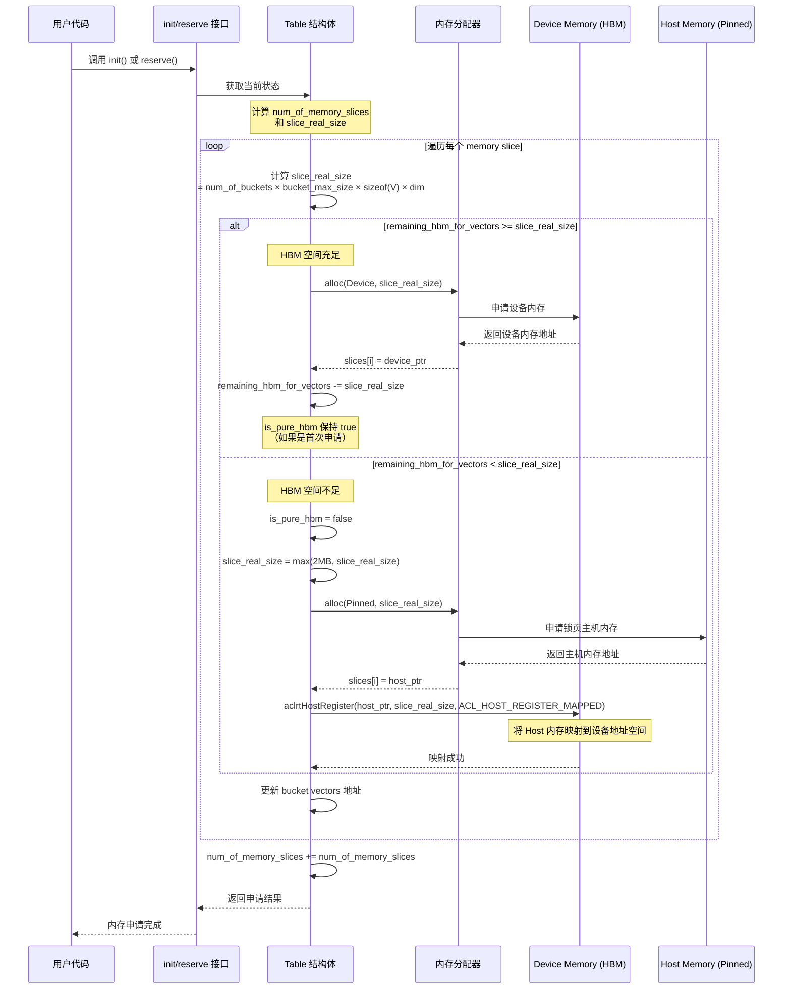
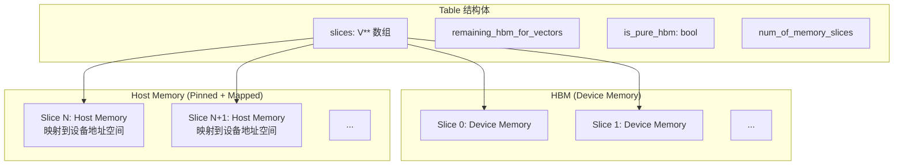

# 内存申请时序图

## init/reserve 接口内存申请流程



## 关键判断逻辑

```mermaid
flowchart TD
    A[开始申请 slice 内存] --> B[计算 slice_real_size]
    B --> C{remaining_hbm_for_vectors<br/>>= slice_real_size?}
    
    C -->|是| D[申请 Device Memory]
    D --> E[remaining_hbm_for_vectors -= slice_real_size]
    E --> F{is_pure_hbm?}
    F -->|是| G[保持 is_pure_hbm = true]
    F -->|否| H[设置 mixed_hbm = true]
    G --> I[记录 slices[i] = device_ptr]
    H --> I
    
    C -->|否| J[设置 is_pure_hbm = false]
    J --> K[slice_real_size = max(2MB, slice_real_size)]
    K --> L[申请 Pinned Host Memory]
    L --> M[aclrtHostRegister 映射内存]
    M --> N[记录 slices[i] = host_ptr]
    N --> I
    
    I --> O{还有更多 slice?}
    O -->|是| A
    O -->|否| P[更新 num_of_memory_slices]
    P --> Q[结束]
```

## 内存布局示意



## 状态变化说明

| 阶段 | remaining_hbm_for_vectors | is_pure_hbm | 说明 |
|------|---------------------------|-------------|------|
| 初始 | max_hbm_for_vectors | true | 全部 HBM 可用 |
| 申请 Device 内存后 | 减少 | true/混合 | HBM 减少 |
| 申请 Host 内存后 | 不变 | false | 开始使用 Host 内存 |

## 关键代码路径

```cpp
// table.h 第 165-186 行
size_t slice_real_size = num_of_buckets_in_one_slice *
                         (*table)->bucket_max_size * sizeof(V) *
                         (*table)->dim;

if ((*table)->remaining_hbm_for_vectors >= slice_real_size) {
    // 路径1: HBM 空间充足，申请 Device Memory
    allocator->alloc(MemoryType::Device, (void**)&((*table)->slices[i]),
                     slice_real_size);
    (*table)->remaining_hbm_for_vectors -= slice_real_size;
} else {
    // 路径2: HBM 空间不足，申请 Host Memory
    (*table)->is_pure_hbm = false;
    const size_t host_min_size = MB(2);
    slice_real_size = std::max(host_min_size, slice_real_size);
    allocator->alloc(MemoryType::Pinned, (void**)&((*table)->slices[i]),
                     slice_real_size);
    // 注册映射，使设备可以访问主机内存
    NPU_CHECK(aclrtHostRegister(static_cast<void*>((*table)->slices[i]),
                                slice_real_size, ACL_HOST_REGISTER_MAPPED,
                                &stub_ptr));
}
```
